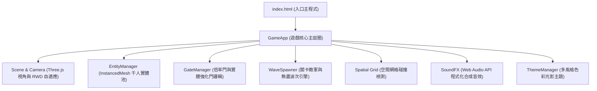

# 🛡️ 軍團防線：增殖衝擊 (Mob Defense: Swarm Rush)

[](https://threejs.org/)
[](https://developer.mozilla.org/en-US/docs/Web/API/WebGL_API)
[](https://github.com/)
[](LICENSE)
[-brightgreen?style=flat-square)]()

> **「精準操控砲火穿過數學倍率門，瞬間觸發幾何級數的萬人藍色大軍，如海嘯般正面粉碎壓境紅軍的極致爽快感！」**

《軍團防線：增殖衝擊》是一款受經典副玩法廣告素材與《Mob Control》啟發，基於 **Three.js** 與原生 WebGL 開發的 3D 超休閒數學增殖塔防射擊遊戲。零外部肥大依賴、無需下載安裝，透過瀏覽器點開即玩，支援手機直式螢幕觸控與桌面端鍵鼠微操。

---

## 📸 遊戲畫面預覽

```
┌────────────────────────────────────────────────────────┐
│                        [關卡進度 / 無盡波次]             │
│                                                        │
│                  👾 👾 👾 👾 👾 (紅軍步兵垂直壓境)      │
│                         👹 (巨型 3D Boss)              │
│                                                        │
│               ┌───────┐             ┌───────┐          │
│               │  ×3   │             │  +20  │          │
│               └───────┘             └───────┘          │
│                    ▲                    ▲              │
│                    │ 幾何級數藍軍海嘯衝鋒 │              │
│                    │                    │              │
│               ┌─────────────────────────────┐          │
│               │ ⚡ [射速門]      💥 [重砲門] │ (實體強化)│
│               └─────────────────────────────┘          │
│                                                        │
│                    [ ▄︻┳═一 玩家多聯裝砲台 ]           │
│                      ◀── (左右滑動瞄準) ──▶            │
└────────────────────────────────────────────────────────┘
```

---

## ✨ 核心特色與機制創新

### 1. 🚪 數學倍率門動態增殖 (Math Multiplier Gates)
- **幾何級數暴兵**：砲火穿透倍率門（`+10`、`×2`、`×3`），以幾何倍率複製兵力，形成千人規模的藍色海嘯。
- **動態軌道巡弋**：包含固定門、橫向正弦巡弋門，考驗玩家邊打邊移的微操節奏。

### 2. ⚡ 戰場實體強化門即時養成 (In-Game Real-Time Power-Ups)
- **拒絕局外農金幣**：徹底揚棄繁雜的農幣升級與課金陷阱，能力提升全部回歸局內即時戰術抉擇！
- **彈幕充能解鎖**：
  - 💥 **多聯裝重砲 (Multi-Barrels)**：吸附充能即時從雙管齊射升級為三管、四管重砲，火力覆蓋半邊跑道。
  - ⚡ **射速超頻 (Fire Rate Overdrive)**：開火頻率提升 25%，可多次疊加達到機槍般的瘋狂掃射。
  - 🛡️ **防線護盾修復 (Shield Restore)**：及時修復底線生命，提供戰術容錯空間。
  - 🌟 **戰術大招充能 (Skill Overcharge)**：瞬間重置全屏雷射光砲冷卻時間，隨時力挽狂瀾。

### 3. 🎯 純直向軌道對撞系統 (Strict Straight-Line Kinematics)
- **零隨機偏折、絕不轉彎**：子彈發射後與增殖後的藍軍士兵，以及迎面撲來的敵方大軍（紅軍步兵、石像鬼、Boss），行進向量恆為垂直直線（$V_x = 0$）。
- **可預測性極佳**：將對戰簡化為清晰的「縱向軌道對位攔截」，徹底消除隨機轉向造成的漏怪挫折感。

### 4. 👾 多維度敵軍陣容與巨型 Boss
- **紅軍常規步兵**：成群結隊直線推進，考驗基礎兵力抵消。
- **低空石像鬼 (Gargoyle)**：高速直線俯衝底線，需迅速移位精準集火。
- **巨型 3D 衝撞 Boss**：具備獨立骨骼動力學與踩踏衝擊波，體型龐大且具備高血量，需集中多管齊射連續阻截。

### 5. 🚀 千人同屏 60 FPS 極致效能
- **`THREE.InstancedMesh`**：千名小兵同屏僅需單次 Draw Call 即可渲染完成。
- **自研 2.5D 空間網格分割 (Spatial Grid Partitioning)**：將廣域物理對撞複雜度從 $O(N^2)$ 降低至 $O(N)$，低階手機瀏覽器也能維持 60 FPS 順暢體驗。

### 6. 🎵 原生 Web Audio 即時音效引擎
- 無需載入任何外部音效 MP3/WAV，純透過 JavaScript 程式碼合成動態音訊（包含發射 Pop 音、增殖升音階鈴聲、爆炸白噪聲與 Boss 警告音），零資源丟失風險，載入速度達到毫秒級。

---

## 🎮 操作指南

| 平台 | 操作方式 | 動作說明 |
|------|----------|----------|
| **行動端 (Mobile)** | 單指左右滑動螢幕 | 操控砲台橫向移動、自動瞄準發射 |
| **桌面端 (PC)** | 滑鼠左鍵拖曳 | 橫向移動砲台位置 |
| **桌面端 (PC)** | 鍵盤 `A` / `D` 或 `←` / `→` | 微調砲台走位 |
| **技能按鈕** | 點擊右下角大招圖示 / 鍵盤 `Space` | 釋放 Unibeam 全屏集束雷射大招 |

---

## 🏆 遊戲模式

1. **關卡模式 (Stages 1 ~ 10)**：
   - 循序漸進的關卡設計，從基礎倍增教學、移動巡弋門、石像鬼突襲到終極巨型 Boss 戰。
2. **無盡生存模式 (Endless Survival)**：
   - 敵人血量與推進速度隨時間線性強化，戰場持續刷新高階強化門，挑戰極限存活秒數並記錄至本地排行榜。

---

## 🛠️ 技術架構

本專案採現代原生 JavaScript (ES Modules) 與模組化物件導向架構設計：



---

## 🚀 快速開始 (Quick Start)

本專案為純前端靜態架構，無須建置步驟（No Build Steps Required）：

### 方式 1：使用本機靜態伺服器 (推薦)
```bash
# 使用 Python 快速啟動
python -m http.server 8080

# 或使用 Node.js http-server / serve
npx serve .
```
啟動後在瀏覽器開啟 `http://localhost:8080` 即可暢玩！

### 方式 2：使用 VS Code 擴充套件
- 在 VS Code 中安裝 **Live Server**。
- 對著 `index.html` 按右鍵，選擇 **"Open with Live Server"**。

---

## 📂 專案結構

```
GameShoot/
├── index.html            # 遊戲完整主程式（Three.js 場景、實體管理、遊戲邏輯與 UI）
├── Docs/
│   └── GDD.md            # 詳細遊戲企劃設計文檔 (Game Design Document v2.1)
├── giant.html / giant2.html # 巨型 Boss 動畫與運動學原型實驗沙盒
├── IronMan.html          # 英雄機甲與大招雷射原型實驗沙盒
├── .agents/              # AI Agent 開發技能與最佳實踐指引
├── .gitignore            # Git 忽略設定
└── README.md             # 專案說明文件
```

---

## 📄 授權條款 (License)

本專案採用 [MIT License](LICENSE) 授權開放。歡迎自由學習、修改與二次開發！
