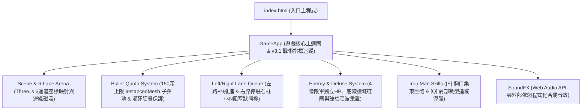

# 🛡️ 軍團防線：增殖衝擊 (Mob Defense: Swarm Rush) — v3.3

[](https://threejs.org/)
[](https://developer.mozilla.org/en-US/docs/Web/API/WebGL_API)
[](https://github.com/)
[-amber?style=flat-square)](Docs/GDD.md)
[](LICENSE)
[-brightgreen?style=flat-square)]()

> **「在 6 通道戰場中極限分配火力——左路穩健回血與超載充能、中路精準釋放集束巨砲打斷敵軍蓄力、右路分期擊碎石柱迎來 ×N 倍率瞬間灌滿 150 顆同屏子彈上限並引爆 Tier 5 極限超載增傷，以密集 4 聯排金色等離子彈幕洪流正面粉碎壓境紅軍的極致策略爽快感！」**

《軍團防線：增殖衝擊》是一款基於 **Three.js** 與原生 WebGL 開發的 3D 超休閒策略射擊／彈幕配額生存塔防遊戲（Casual Tactical Shooter & Bullet-Quota Defense）。本作獨創 **「同屏子彈配額即血條（150 顆上限 / 單排 4 顆寬度）」**、**「滿額火力超載 (Hyper Overcharge Tier 1~5)」** 與 **「左 1 加、中 4 防、右 1 破柱乘算」** 的 6 單位分道博弈機制，搭配敵軍底線週期性蓄力讀條拆彈與鋼鐵人英雄雙主動技能，零外部肥大依賴、免安裝點開即玩，支援手機直式螢幕觸控（含邊緣通道磁吸輔助）與桌面端鍵鼠微操。

---

## 📸 6 通道戰場畫面預覽 (6-Lane Tactical Arena)

```
┌────────────────────────────────────────────────────────────────────────┐
│  [關卡波次 / 無盡計時]     [配額: 150/150 ⚡Lv.5]  [MAX 150! OVERLOAD!] │
├───────────┬────────────────────────────────────────────┬───────────────┤
│  Lane 1   │            Lanes 2 ~ 5 (中路 4 道)          │    Lane 6     │
│ (左1:急救/ │              紅軍四階動態壓境              │ (右1:破柱乘算/│
│  超載充能) │                                            │  直升 Tier 5) │
│  ┌─────┐  │   👾 Lv.1 斥候 (8 HP)  🦇 Lv.2 石像鬼 (22 HP)│   ┌───────┐   │
│  │ +8  │  │        🛡️ Lv.3 重裝巨盾兵 (68 HP / 2.2s 蓄力) │   │  ×10  │   │
│  └──┬──┘  │        👹 Lv.4 毀滅巨像 Boss (350 ~ 550 HP) │   └───┬───┘   │
│     │     │                                            │       ║(阻塞) │
│  ┌──▼──┐  │   ••••••••  (4聯排等離子彈幕 / 169 DPS)     │   ╔═══▼═══╗   │
│  │ +15 │  │   ••••••••  (單發傷害 3.375x 超導極限融化) │   ║ 石 柱 ║   │
│  └──┬──┘  │                                            │   ║ 30~54 ║   │
│     ▼     │   ⭕ [底線蓄力紅圈讀條: 1.0s ~ 3.8s 拆彈]   │   ╚═══════╝   │
├───────────┴────────────────────────────────────────────┴───────────────┤
│  [Q 微型導彈]        🤖 [ ▄︻┳═一 鋼鐵人四聯裝砲台 ]      [E 集束巨砲]  │
│                        ◀─── (6 通道平滑橫移 + 邊緣磁吸) ───▶            │
└────────────────────────────────────────────────────────────────────────┘
```

---

## ✨ 核心特色與機制創新 (v3.3)

### 1. ⚡ 滿編 150 火力超載系統 (Hyper Overcharge System)
- **溢出轉增傷**：當同屏子彈配額達到 `150` 滿編後，再去打左右強化門不再無效，而是全面啟動**「火力超載 (Overload)」**：
  - 單發子彈傷害公式：$D_{\text{bullet}} = 1.5 \times (1.0 + 0.25 \times \text{Tier})$（自基礎 $1.5x$ 飆升至最高 **$3.375x$**，滿編持續輸出高達 **$168.75\text{ DPS}$**）。
- **左路穩健超載 vs 右路狂暴爆發**：
  - **左路 `+N` 門**：每次吸收溢出點數提升 **+1 Tier**，持續時間刷新為 **9.0 秒**。
  - **右路破柱 `×N` 門**：擊碎石柱吸收 `×10 / ×15 / ×20` 門，**直接拉滿至頂級 Tier 5**，持續時間高達 **12.0 秒**！
- **階梯衰減與斷流懲罰**：
  - 維持倒數結束後，以每階 3.0 秒向下衰減（Tier $5 \to 4 \to 3 \dots$）。
  - 若防守失誤被敵軍攻破底線扣除子彈配額（$Q < 150$），超載能量**強制中斷清零**，考驗玩家極限走位與拆彈專注力！

### 2. 🛡️ 敵軍血條與壓迫感全面升級 (High-Pressure Wave Balance)
- **Lv.1 紅軍斥候 (`8 HP`)**：推進速度快，未及時清怪會多列貼臉累積高額扣除。
- **Lv.2 突襲石像鬼 (`22 HP`)**：空中高速突襲，扣除 `-6` 配額，考驗 `[Q]` 導彈制導拆彈。
- **Lv.3 重裝巨盾兵 (`68 HP`)**：前排高威脅肉盾，底線蓄力時間壓縮至 **`2.2 秒`**，單次揮擊造成 **`-20` 配額重創**！若不維持超載傷害，單靠中路站樁絕對無法在 2.2 秒內融化雙盾兵。
- **Lv.4 毀滅巨像 Boss (`350 ~ 550 HP`)**：終極血量巨獸，底線蓄力一拳扣除 **`-45` 配額**，殘血 <30% 狂暴咆哮提速，需仰賴破柱金色震波擊退控場並以 Tier 5 超載彈幕正面斬殺。

### 3. 🛣️ 6 單位橫向分道博弈：「左 1 加、中 4 防、右 1 破柱乘算」
戰場總寬度（$W = 12$）精確切分為 **6 個邏輯通道單位（Lanes 1 ~ 6）**：
- **左路（Lane 1，寬 1 單位）—— 穩健回血與超載充能**：無石柱阻擋。殘血時緊急回血，滿血時吃門疊加超載傷害。
- **中路（Lanes 2~5，寬 4 單位）—— 四階敵軍動態壓境**：垂直直線推進，高壓逼近底線讀條拆彈。
- **右路（Lane 6，寬 1 單位）—— 停駐石柱 + `×N` 狂暴倍增門**：
  - 石柱受擊傷害永久累積；擊碎石柱瞬間釋放**橫向金色破柱震波**（全場敵軍後退擊退 $\Delta Z = +2.0$，全體底線蓄力讀條重置歸零），並解鎖後方 `×N` 門直衝底線觸發 Tier 5 極限超載！

### 2. 💎 同屏子彈配額即血條 (Bullet-Quota Health System)
- **生存與火力合一**：取消傳統獨立血條，玩家當前的「子彈配額 $Q \in [0, 150]$」即是生命值，也是畫面上可同時維持飛行的最大子彈總數；當 $Q \le 0$ 時即告落敗（Game Over）。
- **單排 4 顆寬度 × 同屏 150 顆上限**：砲台每次開火固定並排射出 **4 顆子彈**（收納於 1 個通道寬度內，$V_x = 0$ 筆直飛行）。滿配額 `150 / 150` 時，畫面呈現 **37 排 × 4 顆** 金色流光彈幕瀑布，5 秒內即可正面融化巨型 Boss！
- **瀕死狂暴保護 (Last Stand Buff)**：當配額跌至 $Q \le 8$（不足 2 排）時，系統自動觸發 **射速與子彈飛行速度 +35%** 狂暴加成，助玩家在絕境中拆彈或破柱翻盤。

### 3. ⏱️ 敵軍底線週期性讀條與「極限拆彈」微操
- 敵軍抵達防線底線後不會立即自爆，而是停駐並啟動各自的**蓄力紅圈倒數計時器（`1.0s ~ 4.0s`）**。
- 當敵軍讀條超過 `70%` 時觸發底線紅光警報；若玩家在紅圈填滿前轉火將該敵軍 HP 打空，即可完成**零傷極限拆彈（Last-Second Defuse）**！

### 4. 🤖 鋼鐵人英雄雙主動技能 (Iron Man Active Skills)
- **`[E]` 胸口集束巨砲 (Unibeam)**：釋放高能貫穿光束，瞬間蒸發直線上所有紅軍與護盾。
- **`[Q]` 肩部微型追蹤導彈 (Micro-Missiles)**：齊射多枚具備高拋物線與尾煙軌跡的智慧導彈，精準轟炸中路高威脅目標。

### 5. 📊 v3.1 戰術指標追蹤與指揮官段位評級
- 單局即時統計 **破柱數 (Pillars Broken)**、**滿編 `MAX 150!` 觸發次數**、**底線極限拆彈次數 (Defuses)** 與 **左/中/右三區轉火切換次數**。
- 結算與無盡排行榜自動授予指揮官段位徽章（**青銅新兵 ➔ 白銀衛士 ➔ 黃金統領 ➔ 鑽石戰神 ➔ 王者防線指揮官**）。

### 6. 🚀 恆定 150 子彈池與 60 FPS 極致效能
- 由於同屏子彈嚴格封頂為 `150` 顆，預分配容量 180 的 `THREE.InstancedMesh` 搭配 6 通道空間分桶碰撞檢測（Lane Bucket Culling），徹底根除後期數值膨脹導致的手機發燙與掉幀問題，任何裝置皆穩定 60 FPS。

---

## 🎮 操作指南

| 平台 | 操作方式 | 動作說明 |
|------|----------|----------|
| **行動端 (Mobile)** | 單指於螢幕下緣左右滑動 | 操控鋼鐵人砲台橫跨 6 個通道（具備 1.15x 靈敏度增益與 Lane 1 / Lane 6 邊緣磁吸對齊） |
| **桌面端 (PC)** | 滑鼠左鍵按住拖曳 | 平滑橫移砲台分配火力（左 1 回血 / 中 4 防守 / 右 1 破柱） |
| **桌面端 (PC)** | 鍵盤 `A` / `D` 或 `←` / `→` | 微調砲台走位 |
| **主動技能 (巨砲)** | 點擊右下角巨砲按鈕 / 鍵盤 `E` 或 `Space` | 釋放胸口集束巨砲 (Unibeam) |
| **主動技能 (導彈)** | 點擊左下角導彈按鈕 / 鍵盤 `Q` | 齊射肩部微型追蹤導彈 (Micro-Missiles) |

---

## 🏆 遊戲模式與成長曲線

1. **關卡模式 (Stages 1 ~ 10)**：
   - 依循 **v3.1 三階段心流曲線**：`0~30s 暖身建立期`（15 秒內破首根 `32 HP` 石柱體驗首次 `MAX 150!`）➔ `30~60s 雙線拉鋸期`（石像鬼與重裝巨盾兵穿插，分期偷打石柱）➔ `60~90s 高潮決戰期`（對決毀滅巨像 Boss，利用左路 `+8/+12` 急救與右路 `×10/×15` 絕地反殺）。
2. **無盡生存模式 (Endless Survival)**：
   - 隨波次動態縮放敵軍血量係數 $M_{\text{HP}}(S)$、右路石柱血量 $\text{HP}_{\text{pillar}}(S, k)$ 與左右路 `+N / ×N` 補給倍率，挑戰極限生存時間、總擊殺數與最高指揮官段位（支援 LocalStorage 本地排行榜）。

---

## 🛠️ 技術架構

本專案採現代原生 JavaScript (ES Modules) 與模組化物件導向架構設計：



---

## 🚀 快速開始 (Quick Start)

本專案為純前端靜態架構，無須建置步驟（No Build Steps Required）：

### 方式 1：使用本機靜態伺服器 (推薦)
```bash
# 使用 Python 快速啟動
python -m http.server 8080

# 或使用 Node.js http-server / serve
npx serve .
```
啟動後在瀏覽器開啟 `http://localhost:8080` 即可暢玩！

### 方式 2：使用 VS Code 擴充套件
- 在 VS Code 中安裝 **Live Server**。
- 對著 `index.html` 按右鍵，選擇 **"Open with Live Server"**。

---

## 📂 專案結構

```
GameShoot/
├── index.html               # 遊戲完整主程式（6 通道戰場、150 顆子彈配額系統、右路石柱佇列、4 階敵軍讀條拆彈與 UI）
├── Docs/
│   └── GDD.md               # 詳細遊戲企劃設計文檔 (Game Design Document v3.1 - 100/100 滿分基準)
├── giant.html / giant2.html # 巨型 Boss 動畫與運動學原型實驗沙盒
├── IronMan.html             # 鋼鐵人英雄機甲與大招雷射原型實驗沙盒
├── .agents/                 # AI Agent 開發技能與 GDD 品質檢核工具 (gdd_utils.py)
├── .gitignore               # Git 忽略設定
└── README.md                # 專案說明文件 (同步至 GDD v3.1)
```

---

## 📄 授權條款 (License)

本專案採用 [MIT License](LICENSE) 授權開放。歡迎自由學習、修改與二次開發！
